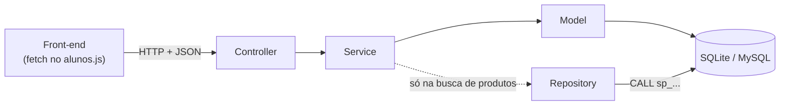
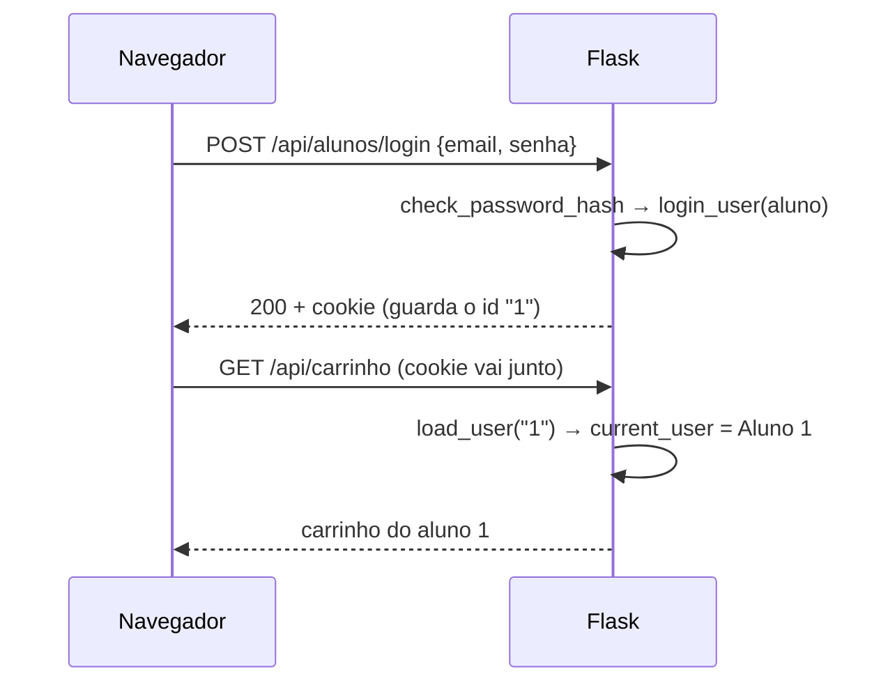

# backend/

A API do sistema, feita em Flask. Ela recebe e devolve **JSON**; quem desenha as telas é o [front-end](../front-end/README.md).

| Arquivo / pasta | O que faz |
|---|---|
| `extensions.py` | Cria `db` (banco, SQLAlchemy) e `lm` (login, LoginManager) **uma única vez**, para todo o projeto importar daqui |
| `routes.py` | `register_routes(app)`: registra todos os controllers no app. **Controller novo precisa ser registrado aqui.** |
| `constantes.py` | Valores fixos do sistema (hoje, as categorias de produto) |
| `tempo.py` | `agora_utc()`: hora atual em UTC, usada nas colunas de data |
| [`controllers/`](controllers/README.md) | Recebem a requisição HTTP e devolvem JSON |
| [`services/`](services/README.md) | Regras de negócio |
| [`models/`](models/README.md) | Tabelas do banco |
| [`repositories/`](repositories/README.md) | Stored procedures do MySQL (busca de produtos) |
| [`database/`](database/README.md) | Script SQL de criação do banco MySQL |

## Camadas

Toda requisição passa pelas mesmas camadas, nesta ordem:



| Camada | Responsabilidade | O que **não** faz |
|---|---|---|
| **Controller** | Define URL e método, lê a requisição, aplica `@login_required`, chama o service, devolve JSON | Regra de negócio ou acesso ao banco |
| **Service** | Regras e validações. Devolve sempre `(dicionário, código_http)` | Não usa `request` nem `jsonify` |
| **Model** | Uma classe por tabela, com `salvar()`, `buscar_por_id()`, `to_dict()` | Decisões de negócio |

### O padrão `resposta, status`

```python
# service
return {"erro": "O carrinho está vazio"}, 400     # deu errado
return carrinho.to_dict(), 200                     # deu certo

# controller
resposta, status = ItemPedidoService.finalizar()
return jsonify(resposta), status
```

| Código | Quando |
|---|---|
| `200` | Deu certo |
| `201` | Algo foi criado |
| `400` | Dados inválidos |
| `401` | Não está logado, ou login errado |
| `404` | Não encontrado |
| `409` | Conflito (ex.: e-mail já cadastrado) |
| `500` | Erro inesperado |

## Como o `app.py` monta o sistema

O `app.py` fica na raiz do projeto. A função `create_app()`:

1. Carrega o `.env` (`load_dotenv()`).
2. Cria o Flask, servindo a pasta `front-end/` em `/front-end`.
3. Configura o banco (`DATABASE_URL`, padrão SQLite), a pasta de imagens (`arquivos/`), o tamanho máximo de upload (6 MB) e a `SECRET_KEY`.
4. Liga o banco (`db.init_app`) e o login (`lm.init_app`). Rotas protegidas sem login respondem `401` em JSON.
5. Registra os controllers (`register_routes(app)`).
6. Define `/` (entrega o `index.html`, ou redireciona para o cadastro se não houver login) e `/api` (lista de rotas).
7. Cria as tabelas que ainda não existem (`db.create_all()`).

> ⚠️ O `app.py` faz `from backend import models`, e o `backend/models/__init__.py` importa **todos** os models, inclusive os que parecem sem uso (`rateio_model`). Sem isso, o SQLAlchemy não encontra as classes dos relacionamentos e **toda consulta ao banco dá erro 500**. Model novo: acrescente-o no `__init__.py` dos models.

## Login (Flask-Login)

O aluno logado fica num **cookie de sessão** assinado com a `SECRET_KEY`; o navegador envia esse cookie sozinho em toda chamada à API.

| Peça | Onde | Papel |
|---|---|---|
| `lm = LoginManager()` | `extensions.py` | Gerenciador do login |
| `Aluno(UserMixin, db.Model)` | `models/aluno_model.py` | O aluno é o usuário do login |
| `Aluno.get_id()` | `models/aluno_model.py` | O que vai no cookie: `str(self.id_aluno)` |
| `@lm.user_loader` | `services/aluno/criar_aluno_service.py` | Do id no cookie de volta para o `Aluno` |
| `@lm.unauthorized_handler` | `app.py` | Sem login, rotas protegidas respondem `401` em JSON |
| `login_user` / `logout_user` | `services/aluno/` | Grava / apaga o aluno da sessão |
| `@login_required` | `controllers/` | Barra a rota sem login |
| `current_user` | services e `app.py` | O aluno da requisição atual |

> **Por que `get_id()`?** O Flask-Login procura um campo `id`, mas a chave do `Aluno` é `id_aluno`. Sem esse método, o `login_user` quebra.



O `current_user` é recalculado **a cada requisição** a partir do cookie dela, por isso cada aluno vê o próprio carrinho. Sem login, `current_user.is_authenticated` é `False`.

**Cuidados:** use `current_user` no service em vez de receber o id do aluno pela URL (senão qualquer um troca o número); a página tem que vir do Flask e o JS deve usar `API_BASE_URL = "/api"`, senão o cookie não vai junto; mudar a `SECRET_KEY` desfaz todos os logins.

## Passo a passo: funcionalidade nova

Exemplo: permitir que o aluno avalie um pedido. **Essa funcionalidade já existe** (`AvaliacaoService` em `services/pedido_service.py`, rota `POST /api/pedidos/<id>/avaliacao`); o exemplo abaixo é uma versão simplificada, para você ver o caminho completo.

**1. Model** (`models/`): se criar uma tabela, importe o arquivo no `models/__init__.py` junto com os outros models.

**2. Service** (`services/avaliacao_service.py`):
```python
from flask_login import current_user
from backend.models.pedido_model import Pedido
from backend.models.avaliacao_model import Avaliacao

class AvaliacaoService:
    @staticmethod
    def avaliar(id_pedido, dados):
        pedido = Pedido.buscar_por_id(id_pedido)
        if not pedido or pedido.id_aluno != current_user.id_aluno:   # só o dono avalia
            return {"erro": "Pedido não encontrado"}, 404
        nota = dados.get("nota")
        if nota not in (1, 2, 3, 4, 5):
            return {"erro": "A nota deve ser de 1 a 5"}, 400
        avaliacao = Avaliacao(id_pedido=id_pedido, nota=nota, comentario=dados.get("comentario"))
        avaliacao.salvar()
        return avaliacao.to_dict(), 201
```

**3. Controller** (`controllers/avaliacao_controller.py`):
```python
from flask import Blueprint, request, jsonify
from flask_login import login_required
from backend.services.avaliacao_service import AvaliacaoService

bp_avaliacao = Blueprint('avaliacoes', __name__, url_prefix='/api/avaliacoes')

@bp_avaliacao.route('/<int:id_pedido>', methods=['POST'])   # (na versão real, a rota fica em pedido_controller.py)
@login_required
def avaliar(id_pedido):
    dados = request.get_json(silent=True) or {}
    resposta, status = AvaliacaoService.avaliar(id_pedido, dados)
    return jsonify(resposta), status
```

**4. Registrar** em `routes.py`:
```python
    from backend.controllers.avaliacao_controller import bp_avaliacao
    app.register_blueprint(bp_avaliacao)
```
E acrescente a rota na lista do `GET /api` (`app.py`) e em [`controllers/README.md`](controllers/README.md).

**5. Front-end:** uma função `async` no `alunos.js`, seguindo o padrão de [`front-end/js/README.md`](../front-end/js/README.md).
