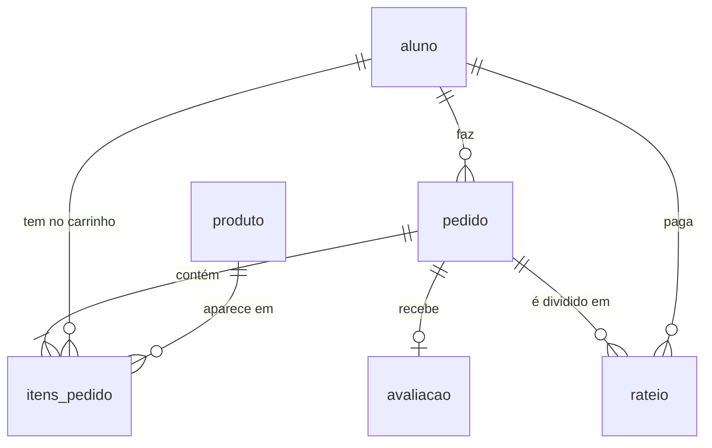
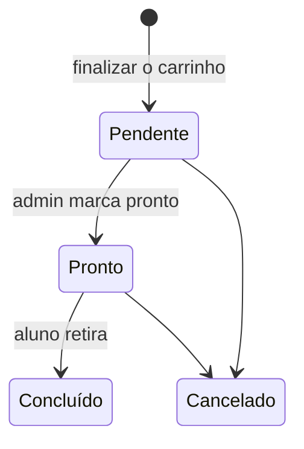

# backend/models/

Uma classe por **tabela do banco** (SQLAlchemy). Os [services](../services/README.md) usam essas classes para ler e gravar.

| Arquivo | Classe | Tabela | Para quê |
|---|---|---|---|
| `aluno_model.py` | `Aluno` | `aluno` | Usuário do sistema e do login |
| `produto_model.py` | `Produto` | `produto` | Itens vendidos pela cantina |
| `pedido_model.py` | `Pedido` | `pedido` | Pedido feito ao finalizar o carrinho |
| `item_pedido.py` | `ItemPedido` | `itens_pedido` | Um produto no carrinho ou num pedido |
| `avaliacao_model.py` | `Avaliacao` | `avaliacao` | Nota e comentário de um pedido entregue |
| `rateio_model.py` | `RateioPagamento` | `rateio` | Divisão do valor entre alunos (ainda sem tela) |

O diagrama de classes está em [`docs/diagrama-de-classes.md`](../../docs/diagrama-de-classes.md).

## Métodos

Todas as classes herdam de `db.Model` e têm:

| Método | O que faz |
|---|---|
| `salvar()` | Adiciona e faz commit |
| `atualizar(...)` | Muda só os campos passados e faz commit |
| `deletar()` | Apaga e faz commit |
| `Model.listar_todos()` | Todos os registros |
| `Model.buscar_por_id(id)` | Um registro, ou `None` |
| `to_dict()` | Converte para dicionário (vira o JSON da API) |

Além desses, o `Pedido` tem `calcular_total()`, e o `ItemPedido` tem `buscar_carrinho(id_aluno)` e `carrinho_to_dict(id_aluno)`.

## Tabelas

| Tabela | Campos principais |
|---|---|
| `aluno` | `id_aluno`, `nome`, `email` (único), `senha` (hash), `saldo`, `funcao` |
| `produto` | `id_produto`, `nome`, `quantidade_estoque`, `preco_atual`, `preco_promocional`, `categoria`, `ingredientes`, `status`, `imagem` |
| `pedido` | `id_pedido`, `codigo`, `status`, `valor_total`, `data_hora_criacao`, `data_hora_retirada`, `id_aluno`, `nome_aluno` |
| `itens_pedido` | `id_item_pedido`, `quantidade`, `preco_unitario_cobrado`, `id_pedido`, `id_aluno`, `id_produto`, `nome_produto` |

## O carrinho

Não existe tabela de carrinho. O carrinho são os **`ItemPedido` que ainda não têm pedido**:

| Onde o item está | `id_aluno` | `id_pedido` |
|---|---|---|
| No carrinho | o dono do carrinho | vazio |
| Num pedido | vazio | o pedido |

Ao finalizar, o `FinalizarPedidoService` cria o `Pedido` e passa os itens do carrinho para ele.

## Histórico preservado

- O item guarda o **preço do momento** (`preco_unitario_cobrado`). Se o preço do produto mudar, os pedidos antigos não mudam.
- `pedido.nome_aluno` e `itens_pedido.nome_produto` guardam uma cópia do nome. Ao excluir um aluno ou produto, os pedidos continuam com esse nome.
