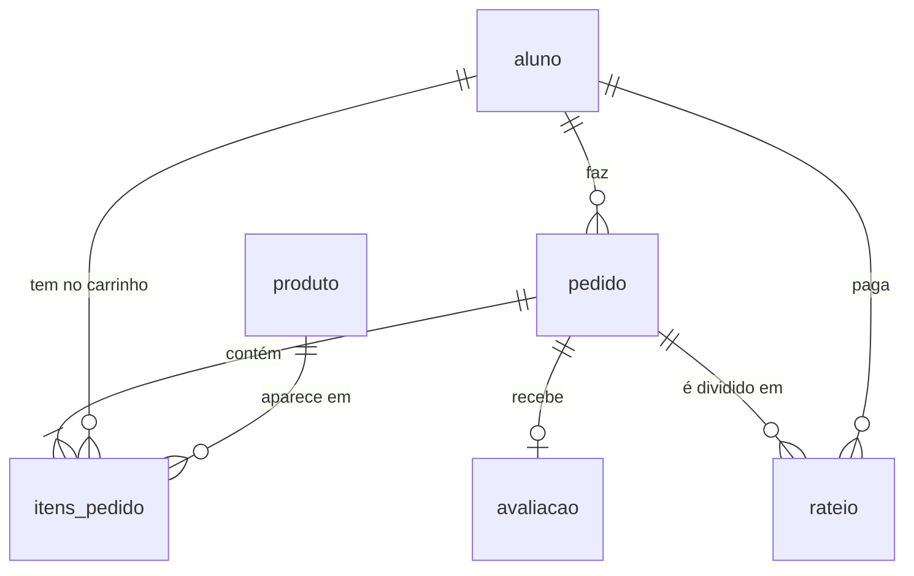
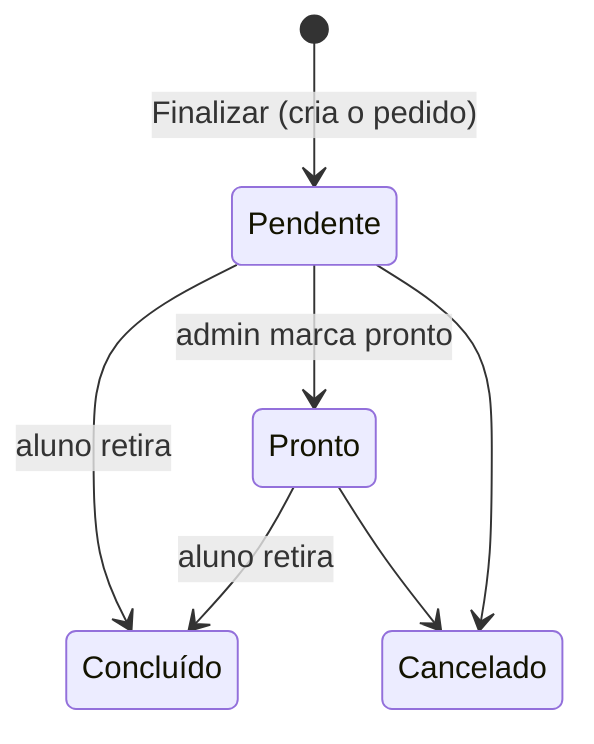

# backend/models/

Uma classe por **tabela do banco** (SQLAlchemy). Os [services](../services/README.md) usam essas classes para ler e gravar.

| Arquivo | Classe | Tabela | Para quê |
|---|---|---|---|
| `aluno_model.py` | `Aluno` | `aluno` | Usuário do sistema. Também é o usuário do login (`UserMixin` + `get_id()`) |
| `produto_model.py` | `Produto` | `produto` | Itens vendidos pela cantina |
| `pedido_model.py` | `Pedido` | `pedido` | Um pedido feito (criado ao finalizar o carrinho) |
| `item_pedido.py` | `ItemPedido` | `itens_pedido` | Cada produto no carrinho ou dentro de um pedido |
| `avaliacao_model.py` | `Avaliacao` | `avaliacao` | Nota (1 a 5) e comentário de um pedido concluído |
| `rateio_model.py` | `RateioPagamento` | `rateio` | Divisão do valor entre alunos. **Ainda sem tela nem rota** |

Todas herdam de `db.Model` e têm `salvar()`, `atualizar()`, `deletar()`, `listar_todos()`, `buscar_por_id()` e `to_dict()`. O `Pedido` tem também `calcular_total()`, e o `ItemPedido` tem `buscar_carrinho(id_aluno)` e `carrinho_to_dict(id_aluno)`.

**Diagrama de classes** (atributos, herança, composição e agregação): [`docs/diagrama-de-classes.md`](../../docs/diagrama-de-classes.md).

> **Atenção:** Todos os models precisam ser **importados no `app.py`**, mesmo os sem rotas. Sem isso, o SQLAlchemy não encontra as classes citadas nos relacionamentos (`'Avaliacao'`, `'RateioPagamento'`) e **toda consulta dá erro 500**. Ao criar um model novo, acrescente-o nesse import.

## Relacionamentos

| Tabela | Campos principais |
|---|---|
| `aluno` | `id_aluno`, `nome`, `email` (único), `senha` (hash), `saldo` |
| `produto` | `id_produto`, `nome`, `quantidade_estoque`, `preco_atual`, `preco_promocional`, `categoria`, `status` (disponível?), `imagem`, `ingredientes`, `tabela_nutricional` |
| `pedido` | `id_pedido`, `status`, `valor_total`, `data_hora_criacao`, `horario_agendado_retirada`, `data_hora_retirada`, `id_aluno`, `nome_aluno` |
| `itens_pedido` | `id_item_pedido`, `quantidade`, `preco_unitario_cobrado`, `id_pedido`, `id_aluno`, `id_produto`, `nome_produto` |

## O carrinho são itens sem pedido

Não existe tabela de carrinho. O carrinho são os **`ItemPedido` que ainda não têm pedido**:

| Onde o item está | `id_aluno` | `id_pedido` |
|---|---|---|
| No carrinho | o dono do carrinho | vazio |
| Em um pedido | vazio | o pedido |

Assim o carrinho continua salvo ao recarregar a página, e a tabela `pedido` só tem pedidos de verdade. Ao finalizar, o `FinalizarPedidoService` cria o `Pedido` e passa os itens do carrinho para ele.

Remover um item do carrinho é só apagar o `ItemPedido` (`item.deletar()`). Ao excluir um aluno, os itens do carrinho dele são apagados junto.

## Histórico preservado

- `pedido.nome_aluno` e `itens_pedido.nome_produto` guardam uma **cópia do nome** no momento do pedido.
- `preco_unitario_cobrado` guarda o **preço daquele momento**; se o preço do produto mudar, os pedidos antigos não mudam.
- Ao excluir um aluno ou produto, o service solta o vínculo (`id_aluno` / `id_produto` ficam vazios) em vez de apagar os pedidos. O `to_dict()` usa o nome atual se o registro ainda existir, senão a cópia.

## Métodos comuns

| Método | O que faz |
|---|---|
| `salvar()` | Adiciona e faz commit |
| `atualizar(...)` | Muda só os campos passados (os `None` são ignorados) e faz commit |
| `deletar()` | Apaga e faz commit |
| `Model.listar_todos()` | Todos os registros |
| `Model.buscar_por_id(id)` | Um registro, ou `None` |
| `to_dict()` | Converte para dicionário (é o que vira JSON na API) |
| `Pedido.calcular_total()` | Soma `preco_unitario_cobrado × quantidade` dos itens |

## Mudando uma tabela

O `db.create_all()` (no `app.py`) cria tabelas novas, mas **não altera** as que já existem. Ao adicionar uma coluna num model:
- **SQLite:** apague o `cantina.db` e rode de novo;
- **MySQL:** faça um `ALTER TABLE` e atualize o [`create-database.sql`](../database/README.md).
