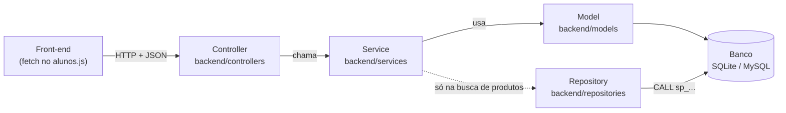

# Arquitetura

O projeto é dividido em duas partes que conversam por HTTP:

- **Front-end** (`front-end/`): páginas HTML estáticas. O JavaScript (`alunos.js`) chama a API com `fetch` e monta as tabelas na tela.
- **Back-end** (`app.py` + `backend/`): uma API Flask que só recebe e devolve **JSON**. Ela não gera HTML; a única exceção é a rota `/`, que entrega o `index.html`.

O próprio Flask também serve os arquivos do front-end, em `/front-end/...`. Por isso a página e a API ficam no **mesmo endereço**, o que é necessário para o cookie de login funcionar (veja [LOGIN.md](LOGIN.md)).

## Camadas do back-end

Cada requisição passa sempre pelas mesmas camadas, nesta ordem:



| Camada | Pasta | Responsabilidade | O que **não** faz |
|---|---|---|---|
| **Controller** | `backend/controllers/` | Define a URL e o método HTTP, lê o corpo/parâmetros da requisição, chama o service e transforma a resposta em JSON. Também aplica `@login_required`. | Não tem regra de negócio nem acessa o banco. |
| **Service** | `backend/services/` | Regras de negócio: validações, cálculos, decidir o código HTTP de resposta. Devolve sempre uma tupla `(dicionário, código_http)`. | Não conhece `request` nem `jsonify`. |
| **Model** | `backend/models/` | Uma classe por tabela do banco (SQLAlchemy). Tem métodos simples como `salvar()`, `buscar_por_id()` e `to_dict()`. | Não decide nada de negócio. |
| **Repository** | `backend/repositories/` | Executa as stored procedures do MySQL (`CALL sp_...`). Usado só pela busca de produtos. | — |

### Exemplo: o caminho de "adicionar ao carrinho"

1. **Front** (`alunos.js`, `adicionarItemAoCarrinho`):
   ```js
   fetch(`${API_BASE_URL}/carrinho/itens`, { method: "POST", body: JSON.stringify({ id_produto, quantidade }) })
   ```
2. **Controller** (`item_pedido_controller.py`): a rota `POST /api/carrinho/itens` exige login, lê o JSON e chama o service.
   ```python
   @bp_item_pedido.route('/itens', methods=['POST'])
   @login_required
   def adicionar_item():
       data = request.get_json(silent=True) or {}
       resposta, status = ItemPedidoService.adicionar_item(data)
       return jsonify(resposta), status
   ```
3. **Service** (`item_pedido_service.py`): valida o produto e a quantidade, cria o carrinho se não existir, soma a quantidade se o produto já estiver nele, recalcula o total e salva. Devolve `(carrinho.to_dict(), 201)` ou um erro como `({"erro": "Produto não encontrado"}, 404)`.
4. **Model** (`pedido_model.py`, `item_pedido.py`): `Pedido` e `ItemPedido` são gravados pelo SQLAlchemy.
5. **Front** recebe o JSON e redesenha o carrinho (`renderizarCarrinho`).

## O padrão `resposta, status`

Todo service devolve **dois valores**: o conteúdo e o código HTTP.

```python
# service
return {"erro": "O carrinho está vazio"}, 400     # deu errado
return carrinho.to_dict(), 200                     # deu certo

# controller
resposta, status = ItemPedidoService.finalizar()
return jsonify(resposta), status
```

No front, `res.ok` é verdadeiro para códigos 200–299; nos outros casos o JSON tem a chave `erro` com a mensagem para o usuário.

| Código | Quando usar |
|---|---|
| `200` | Deu certo (consulta, atualização) |
| `201` | Algo foi criado (cadastro, item no carrinho) |
| `400` | Dados inválidos enviados pelo front |
| `401` | Não está logado, ou login errado |
| `404` | Registro não encontrado |
| `409` | Conflito (ex.: e-mail já cadastrado) |
| `500` | Erro inesperado no servidor |

## Como o app é montado (`app.py`)

Quando você roda `python app.py`, a função `create_app()`:

1. Carrega o `.env` (`load_dotenv()`).
2. Cria o Flask, servindo a pasta `front-end/` em `/front-end`.
3. Configura banco (`DATABASE_URL`), pasta de imagens (`arquivos/`), tamanho máximo de upload (6 MB) e `SECRET_KEY`.
4. Liga o banco (`db.init_app`) e o login (`lm.init_app`). Rotas protegidas sem login respondem `401` em JSON.
5. Registra os controllers com `register_routes(app)` (arquivo `backend/routes.py`).
6. Define `/` (entrega o `index.html` ou redireciona para o cadastro) e `/api` (lista de rotas).
7. Cria as tabelas que ainda não existem (`db.create_all()`).

> **Importante:** o `app.py` importa **todos** os models (`from backend.models import ...`), mesmo os que parecem não usados (`avaliacao_model`, `rateio_model`). Sem isso, o SQLAlchemy não encontra as classes citadas nos relacionamentos e **qualquer consulta ao banco dá erro 500**.

## Mapa dos arquivos do back-end

### Controllers (`backend/controllers/`)

| Arquivo | Prefixo da URL | Assunto |
|---|---|---|
| `aluno_controller.py` | `/api/alunos` | Cadastro, login, logout, aluno atual, CRUD de alunos |
| `produto_controller.py` | `/api/produtos` | CRUD de produtos, busca/filtro, imagem do produto |
| `item_pedido_controller.py` | `/api/carrinho` | Carrinho do aluno logado |
| `pedido_controller.py` | `/api/pedidos` | Listar, consultar e atualizar pedidos |

Todo controller novo precisa ser registrado em `backend/routes.py`.

### Services (`backend/services/`)

| Arquivo | O que faz |
|---|---|
| `aluno/criar_aluno_service.py` | Cadastro (valida, gera hash da senha, já faz login). **Também contém o `user_loader` do Flask-Login.** |
| `aluno/login_aluno_service.py` | Login (confere a senha com `check_password_hash`) e logout |
| `aluno/listar_aluno_service.py` | Lista todos os alunos |
| `aluno/atualizar_aluno_service.py` | Edita nome, e-mail e senha |
| `aluno/deletar_aluno_service.py` | Exclui o aluno, preservando o histórico dos pedidos dele |
| `produto_service.py` | CRUD de produtos e busca (stored procedure no MySQL, ORM no SQLite) |
| `imagem_service.py` | Salva/renomeia a imagem do produto em `arquivos/` |
| `item_pedido_service.py` | Carrinho: ver, adicionar, remover item e finalizar |
| `pedido_service.py` | Pedidos: criar (direto, sem carrinho), listar, consultar e mudar status |

### Outros

| Arquivo | O que faz |
|---|---|
| `backend/extensions.py` | Cria `db` (banco) e `lm` (login) uma única vez, para todo o projeto importar daqui |
| `backend/routes.py` | `register_routes(app)`: registra os controllers |
| `backend/repositories/produto_repository.py` | Chama as procedures `sp_produtos_*` do MySQL |
| `backend/database/create-database.sql` | Cria o banco, as tabelas, as procedures e dados de exemplo no MySQL |

### Arquivos sem uso (podem ser removidos)

| Arquivo | Por quê |
|---|---|
| `backend/models/database.py` | Cria um segundo `db = SQLAlchemy()` que nunca é inicializado; o projeto usa `backend/extensions.py` |
| `backend/repositories/aluno_repository.py` | Só tem imports |
| `backend/repositories/app.py` | Importa `create_app` de um lugar onde ela não existe (dá `ImportError` se executado) |
