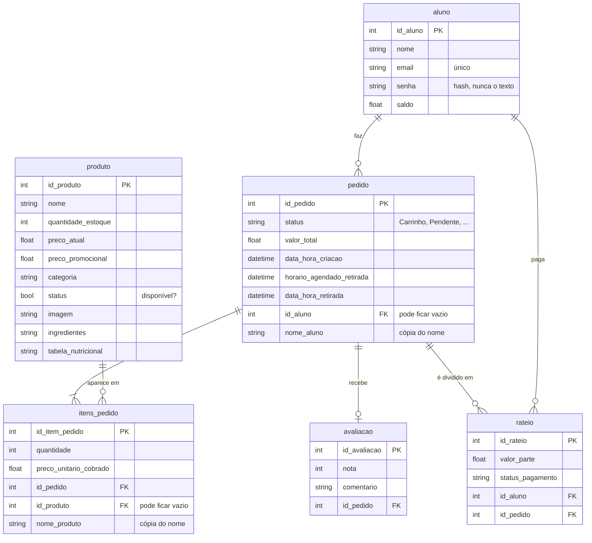
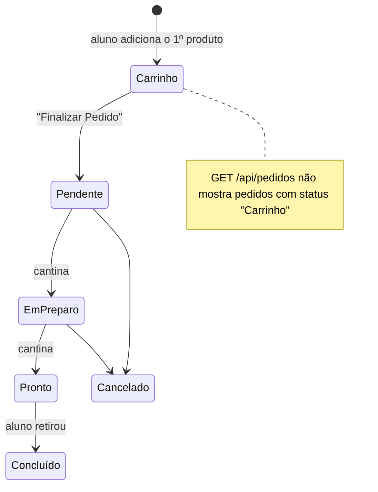

# Banco de dados

Os models ficam em `backend/models/` (um arquivo por tabela). Em desenvolvimento o banco é um arquivo SQLite (`cantina.db`, criado automaticamente); em produção é MySQL, configurado pela variável `DATABASE_URL` no `.env`.

## Tabelas e relacionamentos

| Model (arquivo) | Tabela | Para quê |
|---|---|---|
| `Aluno` (`aluno_model.py`) | `aluno` | Usuário do sistema. Também é o usuário do login (`UserMixin`). |
| `Produto` (`produto_model.py`) | `produto` | Itens vendidos pela cantina |
| `Pedido` (`pedido_model.py`) | `pedido` | Um pedido **ou o carrinho** de um aluno (veja abaixo) |
| `ItemPedido` (`item_pedido.py`) | `itens_pedido` | Cada produto dentro de um pedido |
| `Avaliacao` (`avaliacao_model.py`) | `avaliacao` | Nota de um pedido. **Ainda sem rotas.** |
| `RateioPagamento` (`rateio_model.py`) | `rateio` | Divisão do valor entre alunos. **Ainda sem rotas.** |

## O carrinho é um pedido

Não existe tabela de carrinho. O carrinho de um aluno é um **`Pedido` com `status = "Carrinho"`**, e cada produto adicionado é um `ItemPedido` desse pedido. Isso faz o carrinho:
- continuar salvo se o aluno recarregar a página ou trocar de computador;
- virar pedido só trocando o status, sem copiar dados.

Cada aluno tem no máximo um carrinho aberto: o service procura um pedido `"Carrinho"` do aluno logado e só cria outro se não houver.

## Histórico preservado ("fotos" dos nomes)

`pedido.nome_aluno` e `itens_pedido.nome_produto` guardam uma cópia do nome **no momento do pedido**. Ao excluir um aluno ou um produto, o service solta o vínculo (`id_aluno` / `id_produto` ficam vazios) em vez de apagar os pedidos, e o pedido antigo continua mostrando o nome pela cópia.

Pelo mesmo motivo, `preco_unitario_cobrado` guarda o preço do produto **no momento em que entrou no carrinho**: se o preço mudar depois, os pedidos antigos não mudam.

## Como as tabelas são criadas

- **SQLite (desenvolvimento):** automático. Ao iniciar, o `app.py` roda `db.create_all()`, que cria as tabelas que faltam. Para recomeçar, apague `cantina.db`.
- **MySQL:** rode `backend/database/create-database.sql`. Ele cria o banco `cantina_db`, as tabelas, as 4 procedures de busca de produto e alguns dados de exemplo.

> `db.create_all()` **não altera** tabelas que já existem. Se você adicionar uma coluna num model, no SQLite apague o `cantina.db`; no MySQL faça um `ALTER TABLE` (e atualize o `create-database.sql`).

### Stored procedures (só MySQL)

Usadas pela rota `GET /api/produtos/buscar`, via `backend/repositories/produto_repository.py`:

| Procedure | Parâmetros |
|---|---|
| `sp_produtos_por_categoria` | categoria |
| `sp_produtos_por_faixa_de_preco` | preço mínimo, preço máximo |
| `sp_produtos_ordenar_por_preco` | — |
| `sp_produtos_ordenar_por_nome` | — |

No SQLite elas não existem; o `produto_service.py` detecta o erro e faz a mesma busca pelo ORM.

## Métodos comuns dos models

Todos os models seguem o mesmo padrão:

| Método | O que faz |
|---|---|
| `salvar()` | Adiciona e faz commit |
| `atualizar(...)` | Muda só os campos passados (os `None` são ignorados) e faz commit |
| `deletar()` | Apaga e faz commit |
| `Model.listar_todos()` | Todos os registros |
| `Model.buscar_por_id(id)` | Um registro, ou `None` |
| `to_dict()` | Converte para dicionário (é o que vira JSON na API) |
