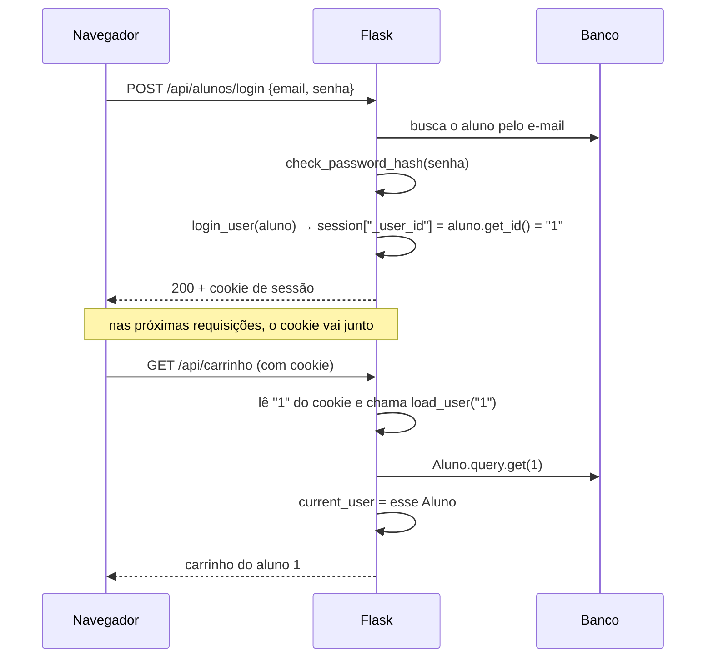

# Login (Flask-Login)

O login usa a biblioteca **Flask-Login**. O aluno logado fica guardado num **cookie de sessão** assinado com a `SECRET_KEY`; o navegador envia esse cookie sozinho em toda chamada à API.

## As peças

| Peça | Onde | Papel |
|---|---|---|
| `lm = LoginManager()` | `backend/extensions.py` | O gerenciador de login, ligado ao app com `lm.init_app(app)` no `app.py` |
| `class Aluno(UserMixin, db.Model)` | `backend/models/aluno_model.py` | O aluno é o "usuário" do login |
| `Aluno.get_id()` | `aluno_model.py` | Diz o que vai no cookie: `str(self.id_aluno)` |
| `@lm.user_loader` → `load_user(id)` | `backend/services/aluno/criar_aluno_service.py` | Faz o caminho de volta: do id no cookie para o objeto `Aluno` |
| `@lm.unauthorized_handler` | `app.py` | Sem login, rotas 🔒 respondem `401` em JSON |
| `login_user(aluno)` | cadastro e login | Grava o aluno na sessão |
| `logout_user()` | `login_aluno_service.py` | Apaga o aluno da sessão |
| `@login_required` | controllers | Barra a rota se ninguém estiver logado |
| `current_user` | services e `app.py` | O aluno da requisição atual |

> **Por que `get_id()`?** O Flask-Login procura um campo chamado `id`, mas a chave do `Aluno` é `id_aluno`. Sem esse método, o `login_user` quebra com `NotImplementedError`.

## Como funciona

O `current_user` **não é uma variável fixa**: a cada requisição ele é recalculado a partir do cookie daquela requisição. Por isso dois alunos em navegadores diferentes veem, cada um, o seu próprio carrinho. Sem login, `current_user` é um usuário anônimo, com `current_user.is_authenticated == False`.

## As telas

| Situação | O que acontece |
|---|---|
| Abrir `/` sem login | `app.py` redireciona para `/front-end/cadastro.html` |
| Cadastrar | `POST /api/alunos/registro` cria o aluno, já faz login, e o JS leva para `/` |
| Entrar | `login.html` → `POST /api/alunos/login` → `/` |
| Nome no topo | `alunoInf()` chama `GET /api/alunos/atual` |
| Sair | botão "logout" → `POST /api/alunos/logout` → `login.html` |

## Cuidados

- **Senha:** só o hash é salvo (`generate_password_hash` no cadastro, `check_password_hash` no login). Nunca grave nem devolva a senha em texto.
- **Mesmo endereço:** a página tem que vir do próprio Flask, e o JS chama a API com caminho relativo (`API_BASE_URL = "/api"`). Se a página for aberta por outro endereço (Live Server, `file://`, ou `localhost` chamando `127.0.0.1`), o navegador não envia o cookie e o login "some".
- **`SECRET_KEY`:** se mudar, todos os logins são desfeitos. Em produção use um valor longo e secreto no `.env`, nunca o padrão do código.
- **Proteger uma rota nova:** coloque `@login_required` logo abaixo do `@bp.route(...)`, e use `current_user` no service em vez de receber o id do aluno pela URL (senão qualquer um troca o número e mexe nos dados de outro aluno).
