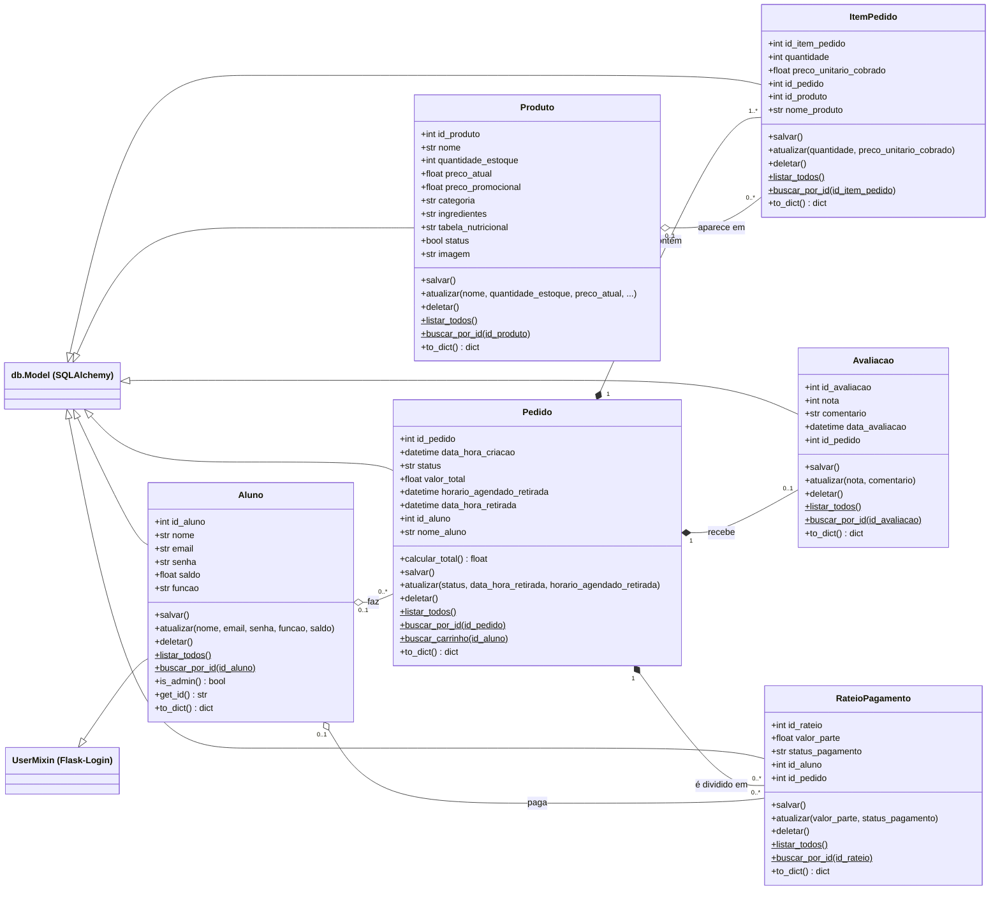

# Diagrama de classes do domínio

As classes abaixo são as **Models** de `backend/models/`. Cada uma é uma tabela do banco
(script em `backend/database/create-database.sql`). A imagem está em
[`diagrama-de-classes.png`](diagrama-de-classes.png); o mesmo diagrama em Mermaid
(que o GitHub desenha sozinho) está logo abaixo.

## Herança

| Classe | Herda de | Por quê |
|---|---|---|
| Todas | `db.Model` | É o que faz a classe virar uma tabela no SQLAlchemy (CRUD convencional) |
| `Aluno` | `UserMixin` também | O aluno é o usuário do login (Flask-Login). O `get_id()` devolve o `id_aluno` para o cookie |

## Relacionamentos

| Relação | Tipo | Como aparece no código |
|---|---|---|
| `Pedido` → `ItemPedido` | **Composição** | `cascade='all, delete-orphan'`: o item só existe dentro do pedido; apagar o pedido (ou tirar o item do carrinho) apaga o item |
| `Pedido` → `Avaliacao` | **Composição** | `uselist=False` e `id_pedido` obrigatório e único: no máximo uma avaliação por pedido, que não existe sem ele |
| `Pedido` → `RateioPagamento` | **Composição** | `id_pedido` obrigatório: cada parte do rateio pertence a um pedido |
| `Aluno` → `Pedido` | **Agregação** | `id_aluno` aceita nulo: ao excluir o aluno, os pedidos continuam no histórico com o `nome_aluno` guardado |
| `Produto` → `ItemPedido` | **Agregação** | `id_produto` aceita nulo: ao excluir o produto, os itens dos pedidos antigos continuam com o `nome_produto` guardado |
| `Aluno` → `RateioPagamento` | **Agregação** | `id_aluno` aceita nulo |

**Carrinho:** não é uma classe à parte. É um `Pedido` com `status = "Carrinho"`; ao finalizar,
o status vira `"Pendente"`. Status possíveis: `Carrinho`, `Pendente`, `Concluído`, `Cancelado`.

**RateioPagamento:** a classe e a tabela existem (pensadas para o requisito "dividir conta"),
mas ainda não há tela nem rota para ela.

`$` no diagrama = método estático (`@staticmethod`), chamado pela classe: `Aluno.buscar_por_id(1)`.
