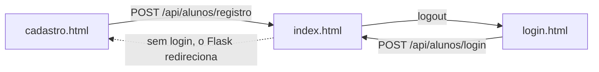

# front-end/

As telas do sistema: HTML, [Bootstrap 5.3](https://getbootstrap.com/docs/5.3/) e JavaScript puro. O Flask serve esta pasta em `/front-end/...`, e o `index.html` também em `/`.

| Arquivo | Endereço | Login | Para quê |
|---|---|---|---|
| `index.html` | `/` | Sim (sem login, vai para o cadastro) | Cardápio: busca pelo nome, categorias, filtros de preço, combos mais pedidos e os cards dos produtos. O botão do carrinho abre o carrinho num painel lateral (com saldo e "Repetir último pedido"); no celular aparece também a barra "Ver carrinho". Mostra o aviso de pedido em preparo; a janela de avaliação abre quando o último pedido é concluído |
| `login.html` | `/front-end/login.html` | | Entrar (`#form-aluno-login`) |
| `cadastro.html` | `/front-end/cadastro.html` | | Criar conta (`#form-aluno`) |
| `pedidos.html` | `/front-end/pedidos.html` | Sim | Meus pedidos: abas "Em andamento" (pedidos `Pendente`, atualiza a cada 30 s) e "Histórico" (concluídos e cancelados, com "Pedir de novo" e "Avaliar") |
| `conta.html` | `/front-end/conta.html` | Sim | Perfil: ver, editar e remover a própria conta; atalhos para carteira, pedidos e administração; botão Sair |
| `carteira.html` | `/front-end/carteira.html` | Sim | Ver o saldo e adicionar saldo (recarga) |
| `admin.html` | `/front-end/admin.html` | Admin ou mestre | Resumo do dia (em preparo, entregues hoje, vendido hoje, estoque baixo) e abas. **Admin:** Pedidos (um card por pedido em preparo, com o código de retirada e os botões Entregar e Cancelar; atualiza a cada 20 s) e Histórico (entregues e cancelados, com filtro e busca). **Mestre:** também Produtos (lista com busca; cadastrar e editar numa janela) e Alunos (tornar admin, excluir). `admin.html#historico` abre direto na aba. Aluno comum é mandado de volta para `/` |
| `css/style.css` | | | Só as cores da cantina por cima do Bootstrap |
| `assets/logo.png` | | | Logo da Cantina Real |
| [`js/alunos.js`](js/README.md) | | | **Todo** o JavaScript das páginas |

## Bootstrap

O Bootstrap 5.3.8 vem do CDN jsDelivr, com `integrity` (o navegador confere se o arquivo não foi alterado).

- O **CSS** está em todas as páginas.
- O **JS** (`bootstrap.bundle.min.js`, com `defer`) está nas páginas logadas (carrinho, menus, abas, janelas e avisos). O login e o cadastro não carregam: lá os avisos viram `alert`.
- **Por que não o Bootstrap 6:** em novembro de 2026 ele ainda é alpha (`6.0.0-alpha.1`), pesa bem mais (CSS 52 KB e JS 60 KB com gzip, contra 31 KB e 24 KB do 5.3.8) e renomeia componentes usados aqui (`offcanvas` → `drawer`, `modal` → `dialog`, sem `form-select` e `text-bg-*`). Vale migrar quando sair a versão estável.
- Antes de escrever CSS, procure uma classe pronta do Bootstrap (espaçamento `mb-3`, grade `row`/`col-md-6`, `d-flex`, `gap-2`...). O `style.css` deve continuar pequeno.
- Para mudar uma cor da cantina, troque as variáveis no topo do `style.css`.
- Ao trocar a versão do Bootstrap, troque também o `integrity` (está na página de download do Bootstrap).

## Ícones (Google Fonts)

Os ícones são do [Material Symbols](https://fonts.google.com/icons), estilo **Rounded**, carregados do Google Fonts por um `<link>` no `<head>` de cada página. Cada ícone é escrito pelo nome:

```html
<span class="material-symbols-rounded icone" aria-hidden="true">shopping_cart</span>
```

- No JS, o `icone("delete")` do `alunos.js` monta esse mesmo `<span>`.
- O `<link>` usa `icon_names=...` com **só os ícones que o site usa**: assim o Google manda um arquivo de uns 10 KB em vez da fonte inteira (vários MB). **Ícone novo:** procure o nome em [fonts.google.com/icons](https://fonts.google.com/icons) e acrescente na lista `icon_names` (em ordem alfabética) de **todas** as páginas. Se esquecer, aparece o nome escrito no lugar do ícone.
- A classe `icone` (no `style.css`) deixa o ícone do tamanho do texto ao lado; `icone-cheio` mostra a versão preenchida (ex.: a estrela).

## Celular

As páginas logadas (cardápio, pedidos, carteira, perfil e administração) têm, no celular, uma **barra de navegação embaixo** (`fixed-bottom d-md-none` com `nav nav-justified`), como num app. No computador ela some e os mesmos links ficam na barra de cima. No fim do `<main>` há um `<div class="d-md-none py-5">` para o conteúdo não ficar escondido atrás dela. Cada página marca o próprio item com `active`. O item **Admin** só aparece para admin e mestre (classe `so-admin`).

## Como as páginas falam com o back-end

Nenhuma página tem dados fixos. Ao abrir, o `alunos.js` chama a API (`/api/...`) com `fetch` e monta as tabelas com a resposta. As rotas estão em [`backend/controllers/README.md`](../backend/controllers/README.md).



## Regras para mexer nas páginas

- **Caminhos absolutos:** use `/front-end/css/style.css`, `/front-end/js/alunos.js`, `/front-end/admin.html`. O `index.html` é aberto em `/`, então um caminho relativo como `css/style.css` viraria `/css/style.css` e daria 404.
- **O que depende da função do usuário** usa as classes `so-admin` (admin e mestre) e `so-mestre` (só mestre), começando com `style="display:none;"`. O `funcaoPorAluno()` do `alunos.js` mostra esses elementos. Isso só esconde da tela: quem realmente bloqueia é o back-end (`@admin_required` / `@master_required` nas rotas e `PAGINAS_ADMIN` no `app.py`).
- **Elementos que o JS mostra e esconde** usam um de dois jeitos: `style="display:none;"` (o JS troca `el.style.display`, ex.: `#secao-combinacoes`) ou a classe `d-none` do Bootstrap (o JS tira e põe a classe com `classList.toggle`, ex.: `#barra-carrinho`). Não misture: `d-none` usa `!important`, então mudar `el.style.display` não mostra um elemento com essa classe.
- **Abra pelo Flask** (`http://127.0.0.1:5000`), não pelo Live Server nem com duplo clique no arquivo. Senão a API fica em outro endereço e o login não funciona.
- **Os `id` dos elementos são usados pelo JS.** Ao renomear um `id` no HTML (ex.: `tabela-carrinho`), procure-o no `alunos.js` e troque lá também.
- **Botões dentro de `<form>`** que não devem enviar o formulário precisam de `type="button"`, senão recarregam a página.
- Depois de mexer, abra o console do navegador (F12) e confira se não há erros em vermelho.
