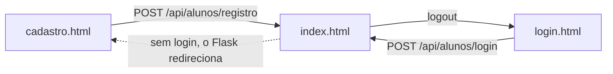

# front-end/

As telas do sistema: HTML, CSS e JavaScript puro, sem framework. O Flask serve esta pasta em `/front-end/...`, e o `index.html` também em `/`.

| Arquivo | Endereço | Login | Para quê |
|---|---|---|---|
| `index.html` | `/` | Sim (sem login, vai para o cadastro) | Cantina: produtos, filtros, carrinho e pedidos. Mostra o nome do aluno e o botão de logout |
| `login.html` | `/front-end/login.html` | | Entrar (`#form-aluno-login`) |
| `cadastro.html` | `/front-end/cadastro.html` | | Criar conta (`#form-aluno`) |
| `admin.html` | `/front-end/admin.html` | | Cadastrar e editar alunos e produtos (com imagem) |
| `css/style.css` | | | Estilo de todas as páginas |
| [`js/alunos.js`](js/README.md) | | | **Todo** o JavaScript das páginas |

## Como as páginas falam com o back-end

Nenhuma página tem dados fixos. Ao abrir, o `alunos.js` chama a API (`/api/...`) com `fetch` e monta as tabelas com a resposta. As rotas estão em [`backend/controllers/README.md`](../backend/controllers/README.md).

## Regras para mexer nas páginas

- **Caminhos absolutos:** use `/front-end/css/style.css`, `/front-end/js/alunos.js`, `/front-end/admin.html`. O `index.html` é aberto em `/`, então um caminho relativo como `css/style.css` viraria `/css/style.css` e daria 404.
- **Abra pelo Flask** (`http://127.0.0.1:5000`), não pelo Live Server nem com duplo clique no arquivo. Senão a API fica em outro endereço e o login não funciona.
- **Os `id` dos elementos são usados pelo JS.** Ao renomear um `id` no HTML (ex.: `tabela-carrinho`), procure-o no `alunos.js` e troque lá também.
- **Botões dentro de `<form>`** que não devem enviar o formulário precisam de `type="button"`, senão recarregam a página.
- Depois de mexer, abra o console do navegador (F12) e confira se não há erros em vermelho.
