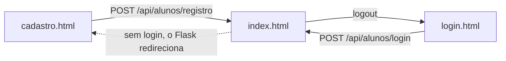

# front-end/

As telas do sistema: HTML, [Bootstrap 5.3](https://getbootstrap.com/docs/5.3/) e JavaScript puro. O Flask serve esta pasta em `/front-end/...`, e o `index.html` também em `/`.

| Arquivo | Endereço | Login | Para quê |
|---|---|---|---|
| `index.html` | `/` | Sim (sem login, vai para o cadastro) | Cantina: combinações mais pedidas, produtos e filtros. O botão 🛒 abre o carrinho num painel lateral (com saldo e "Repetir último pedido"); a janela de avaliação abre quando o último pedido é concluído; o menu com o nome do aluno leva para Minha Conta, Administrador e Logout |
| `login.html` | `/front-end/login.html` | | Entrar (`#form-aluno-login`) |
| `cadastro.html` | `/front-end/cadastro.html` | | Criar conta (`#form-aluno`) |
| `conta.html` | `/front-end/conta.html` | Sim | Ver, editar e remover a própria conta; botão Sair |
| `carteira.html` | `/front-end/carteira.html` | Sim | Ver o saldo e adicionar saldo (recarga) |
| `admin.html` | `/front-end/admin.html` | Admin ou mestre | **Admin:** só os pedidos em andamento (botões Concluir e Cancelar) e o botão do histórico. **Mestre:** também a lista de alunos (promover, excluir) e o cadastro de produtos. Aluno comum é mandado de volta para `/` |
| `historico.html` | `/front-end/historico.html` | Admin ou mestre | Pedidos concluídos e cancelados, do mais recente para o mais antigo |
| `css/style.css` | | | Só as cores da cantina e poucos ajustes por cima do Bootstrap |
| `assets/logo.png` | | | Logo da Cantina Real |
| [`js/alunos.js`](js/README.md) | | | **Todo** o JavaScript das páginas |

## Bootstrap

O Bootstrap 5.3.8 vem do CDN jsDelivr, com `integrity` (o navegador confere se o arquivo não foi alterado).

- O **CSS** está em todas as páginas.
- O **JS** (`bootstrap.bundle.min.js`, com `defer`) só está onde é usado: `index.html` (painel do carrinho, menu do aluno e janela de avaliação). As outras páginas não precisam dele.
- Antes de escrever CSS, procure uma classe pronta do Bootstrap (espaçamento `mb-3`, grade `row`/`col-md-6`, `d-flex`, `gap-2`...). O `style.css` deve continuar pequeno.
- Para mudar uma cor da cantina, troque as variáveis no topo do `style.css`.
- Ao trocar a versão do Bootstrap, troque também o `integrity` (está na página de download do Bootstrap).

## Como as páginas falam com o back-end

Nenhuma página tem dados fixos. Ao abrir, o `alunos.js` chama a API (`/api/...`) com `fetch` e monta as tabelas com a resposta. As rotas estão em [`backend/controllers/README.md`](../backend/controllers/README.md).

## Regras para mexer nas páginas

- **Caminhos absolutos:** use `/front-end/css/style.css`, `/front-end/js/alunos.js`, `/front-end/admin.html`. O `index.html` é aberto em `/`, então um caminho relativo como `css/style.css` viraria `/css/style.css` e daria 404.
- **O que depende da função do usuário** usa as classes `so-admin` (admin e mestre) e `so-mestre` (só mestre), começando com `style="display:none;"`. O `funcaoPorAluno()` do `alunos.js` mostra esses elementos. Isso só esconde da tela: quem realmente bloqueia é o back-end (`@admin_required` / `@master_required` nas rotas e `PAGINAS_ADMIN` no `app.py`).
- **Elementos que o JS mostra e esconde** (ex.: `#btn-cancelar-edicao-produto`, `#secao-combinacoes`) começam com `style="display:none;"`. Não troque pela classe `d-none` do Bootstrap: ela usa `!important` e o JS não conseguiria mostrar o elemento.
- **Abra pelo Flask** (`http://127.0.0.1:5000`), não pelo Live Server nem com duplo clique no arquivo. Senão a API fica em outro endereço e o login não funciona.
- **Os `id` dos elementos são usados pelo JS.** Ao renomear um `id` no HTML (ex.: `tabela-carrinho`), procure-o no `alunos.js` e troque lá também.
- **Botões dentro de `<form>`** que não devem enviar o formulário precisam de `type="button"`, senão recarregam a página.
- Depois de mexer, abra o console do navegador (F12) e confira se não há erros em vermelho.
