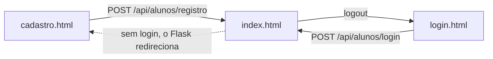

# front-end/

As telas do sistema: HTML, CSS e JavaScript puro, sem framework. O Flask serve esta pasta em `/front-end/...`, e o `index.html` também em `/`.

| Arquivo | Endereço | Login | Para quê |
|---|---|---|---|
| `index.html` | `/` | Sim (sem login, vai para o cadastro) | Cantina: produtos, filtros, carrinho. O menu ☰ leva para Minha Conta, Administrador e Logout |
| `login.html` | `/front-end/login.html` | | Entrar (`#form-aluno-login`) |
| `cadastro.html` | `/front-end/cadastro.html` | | Criar conta (`#form-aluno`) |
| `conta.html` | `/front-end/conta.html` | Sim | Ver, editar e remover a própria conta; botão Sair |
| `admin.html` | `/front-end/admin.html` | Sim | Alunos (mestre), produtos (com imagem) e pedidos (editar status, concluir e avaliar) |
| `css/style.css` | | | Estilo de todas as páginas, dividido em seções (ver o índice no topo do arquivo) |
| `assets/` | | | Logo e imagens usadas nos protótipos |
| [`js/alunos.js`](js/README.md) | | | **Todo** o JavaScript das páginas |

### Protótipos (telas do design ainda não ligadas ao back-end)

Estas páginas mostram **dados fictícios** e têm uma faixa amarela avisando isso. Elas aparecem no fim do `index.html`, na seção "Em desenvolvimento".

| Arquivo | O que mostra | O que falta para funcionar |
|---|---|---|
| `pedido.html` | Carrinho com fotos, botões − e + e horário estimado | Ler o carrinho real (`GET /api/carrinho`); rota para alterar a quantidade; cálculo do tempo de espera |
| `horario.html` | Escolha do dia e horário de retirada | Enviar `horario_agendado_retirada` ao finalizar o carrinho (hoje só o admin edita esse campo) |
| `confirmado.html` | Pedido confirmado com código de retirada (`CR204`) | Gerar um código de retirada para o pedido |
| `pronto.html` | Aviso de pedido pronto | Rota para o aluno ver o status dos **próprios** pedidos (`GET /api/pedidos` é só para admin) |
| `orcamento.html` | Lanches até um valor escolhido | Pode reaproveitar o filtro `preco_max` de `/api/produtos/buscar`; falta a tela usar a API |
| `promocoes.html` | Promoções/combos do dia | Usar `preco_promocional` (já existe no banco) e criar combos |
| `cozinha.html` | Painel da cozinha com abas por status | Ler `GET /api/pedidos` e filtrar por status; hoje isso existe só como tabela no `admin.html` |

## Como as páginas falam com o back-end

Nenhuma página tem dados fixos. Ao abrir, o `alunos.js` chama a API (`/api/...`) com `fetch` e monta as tabelas com a resposta. As rotas estão em [`backend/controllers/README.md`](../backend/controllers/README.md).

## Regras para mexer nas páginas

- **Caminhos absolutos:** use `/front-end/css/style.css`, `/front-end/js/alunos.js`, `/front-end/admin.html`. O `index.html` é aberto em `/`, então um caminho relativo como `css/style.css` viraria `/css/style.css` e daria 404.
- **Sem estilo dentro do HTML:** coloque o CSS no `css/style.css`, na seção da página, em vez de `style="..."` ou `<style>`. Elementos que o JS mostra/esconde (ex.: `#form-editar-pedido`) começam escondidos pelo CSS.
- **Abra pelo Flask** (`http://127.0.0.1:5000`), não pelo Live Server nem com duplo clique no arquivo. Senão a API fica em outro endereço e o login não funciona.
- **Os `id` dos elementos são usados pelo JS.** Ao renomear um `id` no HTML (ex.: `tabela-carrinho`), procure-o no `alunos.js` e troque lá também.
- **Botões dentro de `<form>`** que não devem enviar o formulário precisam de `type="button"`, senão recarregam a página.
- Depois de mexer, abra o console do navegador (F12) e confira se não há erros em vermelho.
