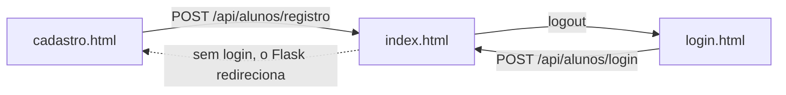

# front-end/

As telas do sistema: HTML, [Bootstrap 5.3](https://getbootstrap.com/docs/5.3/) e JavaScript puro. O Flask serve esta pasta em `/front-end/...`, e o `index.html` também em `/`.

| Arquivo | Endereço | Login | Para quê |
|---|---|---|---|
| `index.html` | `/` | Sim (sem login, vai para o cadastro) | Cardápio: categorias, filtros de preço e ordenação, combos mais pedidos e os cards dos produtos. O botão do carrinho abre o carrinho num painel lateral (com saldo e "Repetir último pedido"); no celular aparece também a barra "Ver carrinho". Mostra o aviso de pedido em preparo |
| `login.html` | `/front-end/login.html` | | Entrar (`#form-aluno-login`) |
| `cadastro.html` | `/front-end/cadastro.html` | | Criar conta (`#form-aluno`) |
| `pedidos.html` | `/front-end/pedidos.html` | Sim | Meus pedidos: abas "Em andamento" (em preparo e **pronto para retirar**, com o código) e "Histórico" (entregues e cancelados, com "Pedir de novo" e "Avaliar") |
| `conta.html` | `/front-end/conta.html` | Sim | Perfil: editar dados, sair e remover a própria conta |
| `carteira.html` | `/front-end/carteira.html` | Sim | Ver o saldo e adicionar saldo (recarga) |
| `admin.html` | `/front-end/admin.html` | Admin ou mestre | Abas. **Admin:** Pedidos (um card por pedido, com o código de retirada; o botão **Pronto** avisa o aluno e o **Entregar** fecha o pedido quando ele retira; também Cancelar) e Histórico. **Mestre:** também Produtos (cadastrar e editar numa janela, com prévia da foto) e Alunos (tornar admin, excluir). Aluno comum é mandado de volta para `/` |
| `css/style.css` | | | Só as cores da cantina por cima do Bootstrap |
| `assets/logo.png` | | | Logo da Cantina Real |
| [`js/`](js/README.md) | | | O JavaScript: um arquivo por página e o `comum.js` |

## Bootstrap

O Bootstrap 5.3.8 vem do CDN jsDelivr, com `integrity` (o navegador confere se o arquivo não foi alterado).

- O **CSS** está em todas as páginas.
- O **JS** (`bootstrap.bundle.min.js`, com `defer`) está nas páginas logadas (carrinho, menus, abas, janelas e avisos). O login e o cadastro não carregam: lá os avisos viram `alert`.
- **Por que não o Bootstrap 6:** em novembro de 2026 ele ainda é alpha (`6.0.0-alpha.1`), pesa bem mais (CSS 52 KB e JS 60 KB com gzip, contra 31 KB e 24 KB do 5.3.8) e renomeia componentes usados aqui (`offcanvas` → `drawer`, `modal` → `dialog`, sem `form-select` e `text-bg-*`). Vale migrar quando sair a versão estável.
- Antes de escrever CSS, procure uma classe pronta do Bootstrap (espaçamento `mb-3`, grade `row`/`col-md-6`, `d-flex`, `gap-2`...). O `style.css` deve continuar pequeno.
- Para mudar uma cor da cantina, troque as variáveis no topo do `style.css`.
- Ao trocar a versão do Bootstrap, troque também o `integrity` (está na página de download do Bootstrap).

## Ícones (Google Fonts)

Os ícones são SVGs copiados de [fonts.google.com/icons](https://fonts.google.com/icons) (Material Symbols **Outlined**) e colados **direto no HTML**. Não há fonte nem arquivo de ícones para carregar.

Para colocar um ícone novo numa página:

1. Em [fonts.google.com/icons](https://fonts.google.com/icons), escolha o ícone e copie o **SVG**.
2. Cole no HTML e troque três coisas: tire o `width`/`height`, troque o `fill="#..."` por `fill="currentColor"` (o ícone fica da cor do texto) e acrescente `class="icone"` e `aria-hidden="true"`:

```html
<svg xmlns="http://www.w3.org/2000/svg" viewBox="0 -960 960 960" class="icone" fill="currentColor" aria-hidden="true"><path d="..."/></svg>
```

- A classe `icone` (no `style.css`) deixa o ícone do tamanho do texto ao lado. Para aumentar, use as classes do Bootstrap no ícone (`fs-4`) ou em volta dele (`display-5`).

## Celular

As páginas logadas (cardápio, pedidos, carteira, perfil e administração) têm, no celular, uma **barra de navegação embaixo** (`fixed-bottom d-md-none` com `nav nav-justified`), como num app. No computador ela some e os mesmos links ficam na barra de cima. No fim do `<main>` há um `<div class="d-md-none py-5">` para o conteúdo não ficar escondido atrás dela. Cada página marca o próprio item com `active`. O item **Admin** só aparece para admin e mestre (classe `so-admin`).

## Como as páginas falam com o back-end

Nenhuma página tem dados fixos. Ao abrir, o JavaScript da página (ver [`js/`](js/README.md)) chama a API (`/api/...`) com `fetch` e monta as tabelas com a resposta. As rotas estão em [`backend/controllers/README.md`](../backend/controllers/README.md).



## Regras para mexer nas páginas

- **Caminhos absolutos:** use `/front-end/css/style.css`, `/front-end/js/comum.js`, `/front-end/admin.html`. O `index.html` é aberto em `/`, então um caminho relativo como `css/style.css` viraria `/css/style.css` e daria 404.
- **O que depende da função do usuário** usa as classes `so-admin` (admin e mestre) e `so-mestre` (só mestre), começando escondido com `d-none`. O `carregarAluno()` do `comum.js` tira o `d-none` conforme a função. Isso só esconde da tela: quem realmente bloqueia é o back-end (`@admin_required` / `@master_required` nas rotas e `PAGINAS_ADMIN` no `app.py`).
- **Elementos que o JS mostra e esconde** começam com a classe `d-none` do Bootstrap; o JS tira e põe a classe com `classList.toggle("d-none", condição)`.
- **Abra pelo Flask** (`http://127.0.0.1:5000`), não pelo Live Server nem com duplo clique no arquivo. Senão a API fica em outro endereço e o login não funciona.
- **Os `id` dos elementos são usados pelo JS.** Ao renomear um `id` no HTML (ex.: `lista-carrinho`), procure-o no `.js` da página e troque lá também.
- **Botões dentro de `<form>`** que não devem enviar o formulário precisam de `type="button"`, senão recarregam a página.
- Depois de mexer, abra o console do navegador (F12) e confira se não há erros em vermelho.
